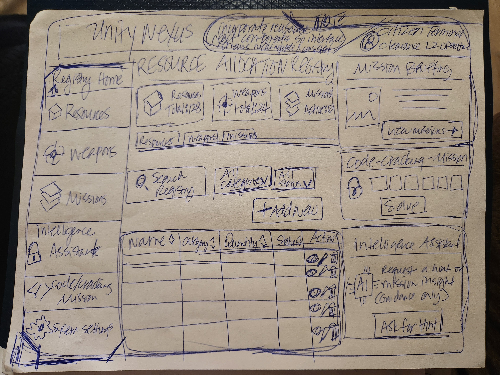

# Unity Nexus Resource Allocation Registry (UNRA)

## Project Overview

**Synth Nova Chronicles | Codex Academy Capstone**

## Wireframe and design

## Technologies Used

- React
- Vite
- JavaScript
- Supabase
- GitHub
- Netlify

## Implemented Features

- [x] Supabase database connection
- [x] Resources Registry
- [x] Missions Registry
- [x] Resource filtering
- [x] GitHub pull request and merge
- [x] Netlify deployment
- [ ] Resolve Weapons Registry API error

## Team

- **Project:** Unity Nexus Resource Allocation Registry (UNRA)
- **Developer:** Individual React + Supabase capstone
- **Collaboration:** Codex Academy pod discussions, planning, and feedback
- **Pod Documentation:** [View Pod Document](https://docs.google.com/document/d/1mQySxORC2Bp30ZHNkmuCxnYR95Vv0X6jM_2CmppKQQk/edit?tab=t.0)
